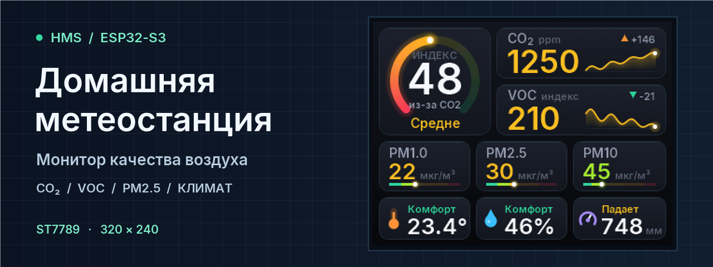
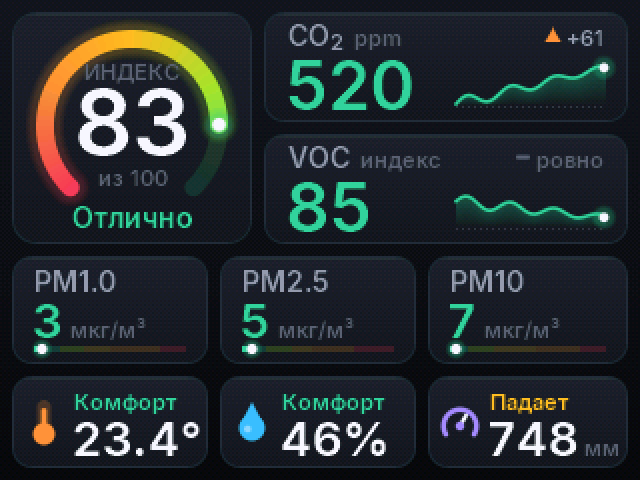
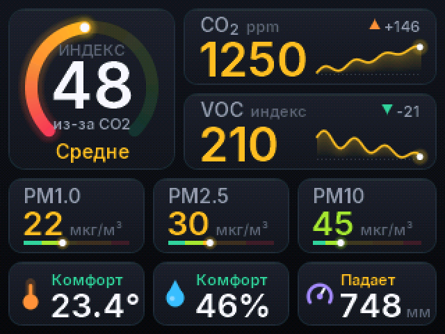
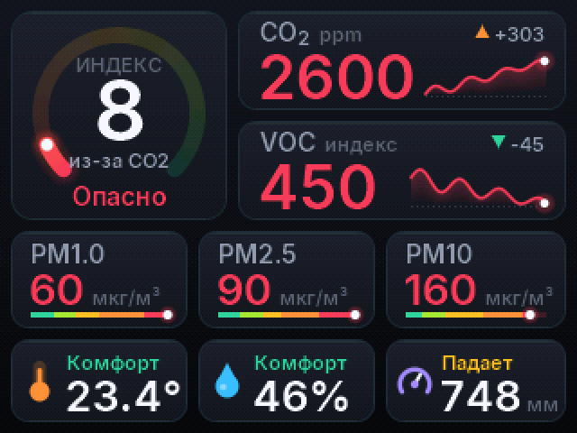

# HMS · Домашняя метеостанция

**HMS — автономная станция для наблюдения за воздухом в помещении.** Она измеряет CO₂, летучие органические соединения, пыль, температуру, влажность и давление. Все показания видны на цветном экране 320 × 240. Обработка данных и отрисовка выполняются на ESP32‑S3.

[Экран и деморежим](#экран-и-деморежим) · [Компоненты](docs/COMPONENTS.md) · [Схема](docs/HARDWARE.md) · [Сборка](docs/USAGE.md) · [Архитектура](docs/ARCHITECTURE.md)

## Экран и деморежим

| Отлично | Средне | Опасно |
| :---: | :---: | :---: |
|  |  |  |

Кадры отрисованы интерфейсом прошивки на демонстрационных данных. [Все уровни и состояния датчиков](docs/USAGE.md#демонстрационные-кадры)

- **Индекс воздуха от 0 до 100.** Учитывает CO₂, VOC, PM2.5 и PM10. Под кольцом видно, какой показатель снизил оценку.
- **История измерений.** Графики CO₂ и VOC за час с изменением за 15 минут, шкалы пыли по трём фракциям и тренд давления за три часа.
- **Демо через USB.** Пять сценариев качества воздуха и выгрузка кадров в PNG через скрипт из репозитория.

## Как устроена станция

| Узел | Реализация |
| --- | --- |
| Контроллер и экран | ESP32‑S3 и цветной TFT на ST7789V |
| Климат и VOC | SHT40, BMP280 и SGP40 на общей шине I²C |
| CO₂ и пыль | MH‑Z19B и PMS7003 на отдельных UART |
| Интерфейс | Отрисовка в RGB565, сглаженная графика и растровый Inter с кириллицей |

Прошивка хранит историю измерений в кольцевых буферах. При ограниченной памяти она рисует экран полосами и обновляет его, когда меняется содержимое. [Архитектура прошивки](docs/ARCHITECTURE.md)

## Документация

| Раздел | Содержание |
| --- | --- |
| [Компоненты](docs/COMPONENTS.md) | Назначение, диапазоны, точность, питание и паспорта датчиков |
| [Схема подключения](docs/HARDWARE.md) | Распиновка из прошивки, питание и проверка первого запуска |
| [Сборка и эксплуатация](docs/USAGE.md) | Arduino IDE, параметры платы, команды USB и демонстрационные кадры |
| [Готовые сборки](https://github.com/turbovanya/HMS-v1---home-meteostation-esp32s3/actions/workflows/build.yml) | Бинарные файлы в артефакте `firmware` успешного запуска GitHub Actions |
