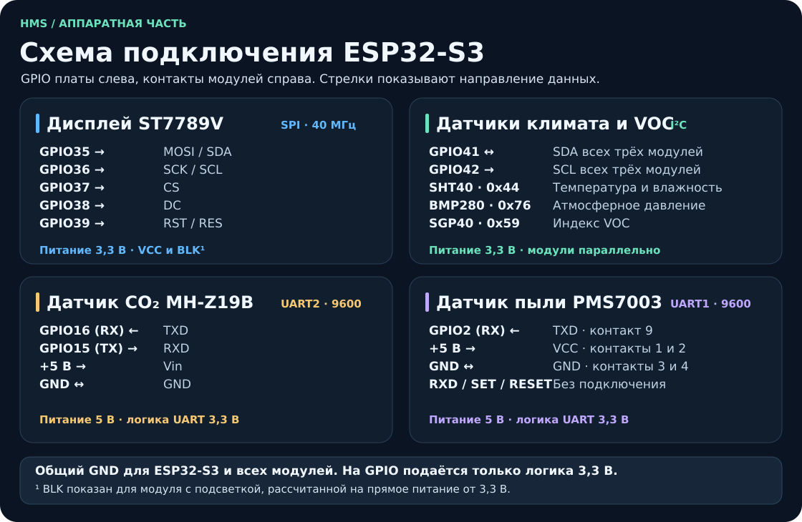
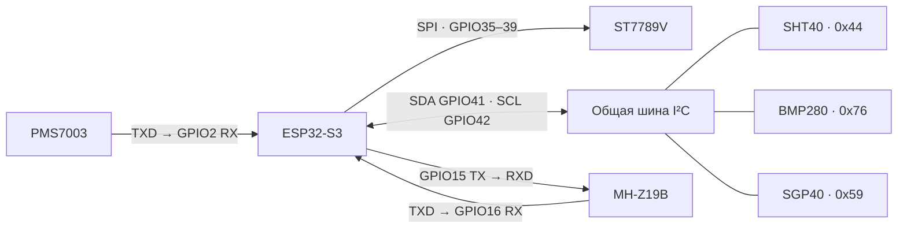

# Компоненты и подключение HMS

[Вернуться к проекту](../README.md) · [Характеристики компонентов](COMPONENTS.md) · [Открыть прошивку](../MeteoStation/MeteoStation.ino) · [Как устроен интерфейс](ARCHITECTURE.md)

Номера GPIO, скорость SPI, порты UART и адрес BMP280 взяты из [MeteoStation.ino](../MeteoStation/MeteoStation.ino). GPIO обозначают номера выводов микроконтроллера. Подписи на разъёмах зависят от конкретной платы и модуля.

## Что понадобится

| Количество | Компонент | Роль в станции |
| :---: | --- | --- |
| 1 | **ESP32-S3** с 4 МБ flash и доступными GPIO35–39, GPIO41–42, GPIO2, GPIO15–16 | Опрос датчиков, расчёт индекса воздуха и отрисовка экрана |
| 1 | **ST7789V**, цветной SPI-модуль 240 × 320 | Работает горизонтально в режиме 320 × 240 |
| 1 | **SHT40** | Измеряет температуру и влажность. Прошивка использует оба значения и для компенсации SGP40 |
| 1 | **BMP280** | Измеряет атмосферное давление. Прошивка выводит его в мм рт. ст. и рассчитывает тренд за 3 часа |
| 1 | **SGP40** | Даёт сигнал, из которого алгоритм Sensirion рассчитывает относительный индекс летучих органических соединений (VOC) |
| 1 | **MH-Z19B** | Измеряет концентрацию CO₂ в ppm и отвечает на запрос ESP32-S3 |
| 1 | **PMS7003** с подходящим шлейфом или переходником | Передаёт оценки концентрации PM1.0, PM2.5 и PM10 в мкг/м³ |
| — | Источник 5 В, USB-кабель с передачей данных и провода | Питание, загрузка прошивки и отладка по USB |

> [!IMPORTANT]
> GPIO35–37 должны быть свободны и выведены на разъём. У вариантов ESP32-S3 с octal flash или octal PSRAM эти GPIO могут быть заняты памятью. Проверьте схему конкретной платы перед сборкой. [Документация Espressif](https://docs.espressif.com/projects/esp-idf/en/v4.4.6/esp32s3/api-reference/peripherals/gpio.html)

## Как связаны модули

## Питание

| Линия | Куда подключить |
| --- | --- |
| **3,3 В** | VCC дисплея, питание модулей SHT40, BMP280 и SGP40 |
| **5 В** | Vin датчика MH-Z19B, VCC датчика PMS7003 |
| **GND** | ESP32-S3, дисплей, все датчики и минус источника питания |

Оба UART-датчика питаются от 5 В и обмениваются данными с ESP32-S3 на уровнях **3,3 В**. Контакт 5 В на отладочной плате используйте для питания датчиков только если её схема допускает такой режим и источник выдерживает нагрузку. При отдельном источнике 5 В для датчиков объедините его GND с GND ESP32-S3.

## Дисплей ST7789V

Аппаратный SPI работает на **40 МГц**. Экран получает данные от ESP32-S3. Линия MISO не используется. На некоторых SPI-модулях контакт **SDA** означает вход MOSI, а **SCL** — тактирование SPI.

| Контакт дисплея | ESP32-S3 |
| --- | --- |
| MOSI / SDI / SDA | GPIO35 |
| SCK / SCLK / SCL | GPIO36 |
| CS | GPIO37 |
| DC / D-C | GPIO38 |
| RST / RES | GPIO39 |
| VCC | 3,3 В |
| BLK / BL | 3,3 В, если модуль рассчитан на прямое питание подсветки от 3,3 В |
| GND | GND |

## Общая шина I²C

Подключите **SDA всех трёх модулей к GPIO41**, а **SCL — к GPIO42**. Модули соединяются параллельно. Линии SDA и SCL должны подтягиваться к 3,3 В. Сначала проверьте, есть ли подтяжки на модулях.

| Модуль | Адрес | Что проверить |
| --- | :---: | --- |
| SHT40 | `0x44` | Температура и влажность берутся с одного датчика |
| BMP280 | `0x76` | Для I²C контакт CSB должен быть в высоком состоянии, SDO — в низком для адреса `0x76`. На готовых модулях это может задаваться перемычками. [Datasheet Bosch](https://www.bosch-sensortec.com/media/boschsensortec/downloads/datasheets/bst-bmp280-ds001.pdf) |
| SGP40 | `0x59` | Датчик использует ту же шину и те же линии питания |

## Два UART

Оба порта работают в режиме **9600 бод, 8N1**. В таблицах TX и RX указаны со стороны соответствующего устройства.

| MH-Z19B · UART2 | ESP32-S3 или питание |
| --- | --- |
| TXD | GPIO16 (RX) |
| RXD | GPIO15 (TX) |
| Vin | 5 В |
| GND | GND |

Контакты PWM и калибровки прошивка не использует. После включения дайте датчику около трёх минут на прогрев. [Руководство Winsen](https://www.winsen-sensor.com/d/files/infrared-gas-sensor/ndir-co2-sensor/mh-z19b-co2-manual%28ver1_6%29.pdf)

| PMS7003 · UART1 | ESP32-S3 или питание |
| --- | --- |
| TXD, контакт 9 | GPIO2 (RX) |
| VCC, контакты 1 и 2 | 5 В |
| GND, контакты 3 и 4 | GND |
| RXD, SET, RESET | Не подключаются |

PMS7003 сам передаёт кадры. Прошивка проверяет контрольную сумму и читает поля концентрации для атмосферного воздуха. Перед подключением сверьте ориентацию разъёма по схеме датчика или маркировке переходника. [Руководство Plantower](https://download.kamami.pl/p564008-PMS7003%20series%20data%20manua_English_V2.5.pdf)

## Первый запуск

1. Проверьте питание и общую землю, затем подключите USB и [загрузите прошивку](USAGE.md#сборка-и-прошивка).
2. Откройте монитор порта на **115200** и отправьте `0`. Должен появиться демоэкран «Отлично». Если экран пустой, сначала проверьте питание подсветки и линии SPI, затем убедитесь, что монитор открыт на USB-порту платы.
3. Отправьте `r` для возврата к датчикам. Если пропали показания сразу со всех I²C-модулей, проверьте SDA, SCL, питание и подтяжки. Если отсутствует только давление, проверьте адрес BMP280.
4. Если нет CO₂ или пыли, проверьте питание 5 В, общую землю и направление TX/RX. SGP40 может показывать «прогрев…» в течение первых десятков секунд.
5. Для установки в корпус разместите SHT40 у вентиляционного отверстия, вдали от нагрева платы. Оставьте свободными вход и выход воздуха PMS7003.

[Команды USB и сохранение снимков](USAGE.md#команды-по-usb)
