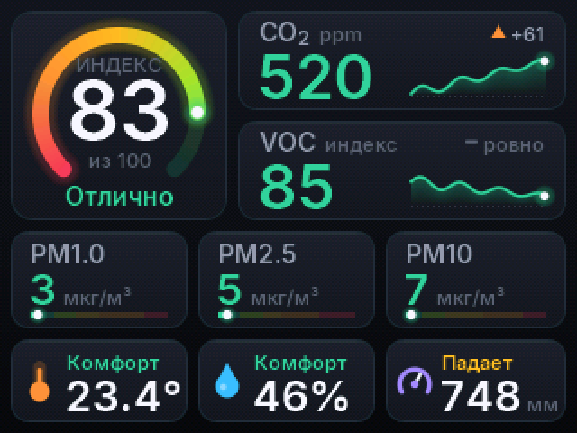
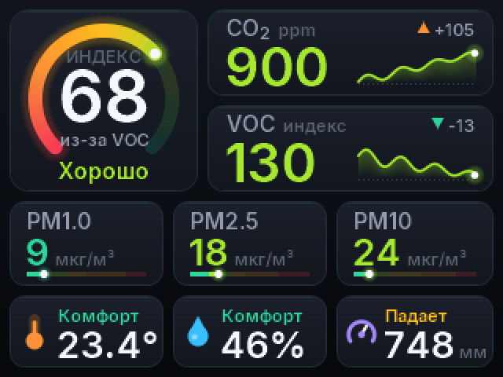
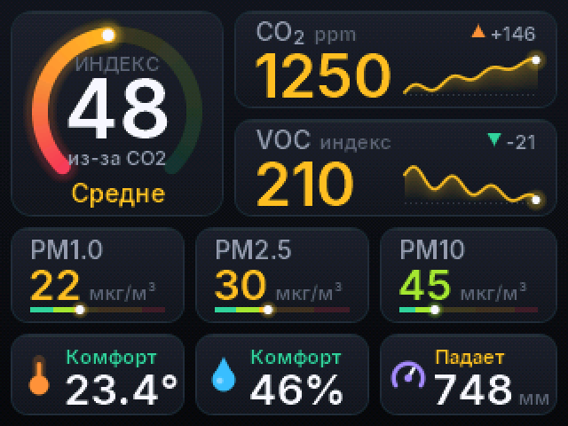
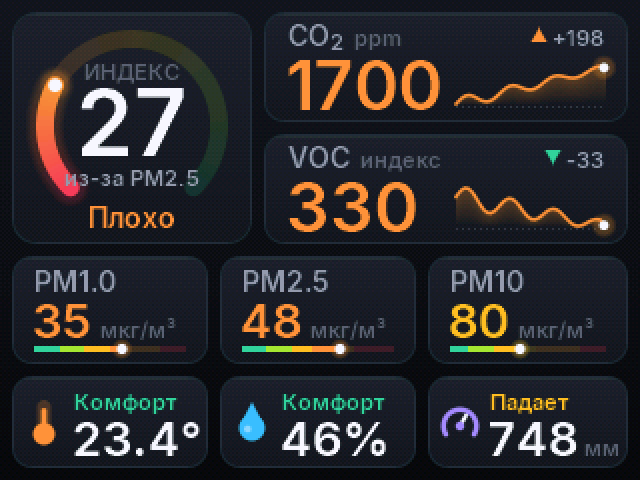
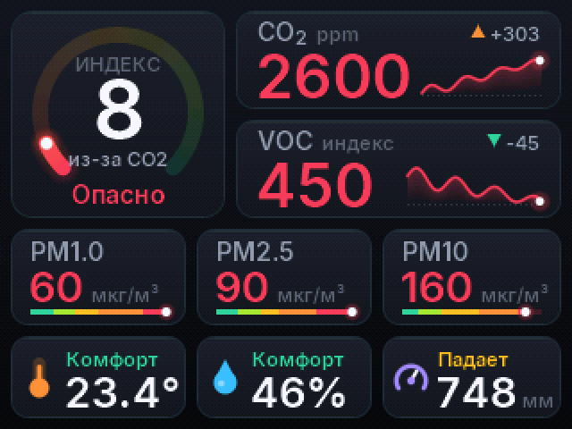

# Сборка и эксплуатация HMS

[Главная проекта](../README.md) · [Схема подключения](HARDWARE.md) · [Характеристики компонентов](COMPONENTS.md)

## Сборка и прошивка

Нужны Arduino IDE 2 (или `arduino-cli`), ядро **esp32 2.0.17** и библиотеки:

| Библиотека | Версия |
|---|---|
| Adafruit GFX Library | 1.12.6 |
| Adafruit ST7735 and ST7789 Library | 1.11.0 |
| Adafruit SHT4x Library | 1.0.5 |
| Adafruit BMP280 Library | 3.0.0 |
| Sensirion I2C SGP40 | 0.1.0 |
| Sensirion Gas Index Algorithm | 3.2.3 |

### Arduino IDE

Открыть `MeteoStation/MeteoStation.ino`, выбрать плату **ESP32S3 Dev Module** и настройки:

- USB Mode: Hardware CDC and JTAG
- **USB CDC On Boot: Enabled** (без этого прошивка работает, но команды по USB недоступны)
- Flash Size: 4MB, Partition Scheme: Default 4MB with spiffs, PSRAM: Disabled

### Скрипт (Windows)

```bash
powershell -ExecutionPolicy Bypass -File tools\flash.ps1 -Port COM3
```

Скрипт использует `arduino-cli` из комплекта Arduino IDE 2. Только собрать, без прошивки: ключ `-NoUpload`.

### CI

GitHub Actions собирает прошивку на каждый пуш, готовые `.bin` лежат в артефактах сборки
(вкладка Actions, артефакт `firmware`). [Открыть сборки](https://github.com/turbovanya/HMS-v1---home-meteostation-esp32s3/actions/workflows/build.yml)

## Команды по USB

Любой монитор порта, скорость 115200, команда из одного символа:

| Команда | Действие |
|---|---|
| `s` | снимок экрана (бинарный кадр RGB565, читает `tools/screenshot.ps1`) |
| `d` | демо: значения плавно проходят все уровни |
| `0`..`4` | демо фиксированного уровня (0 отлично, 4 опасно) |
| `r` | вернуться к реальным данным |
| `i` | время кадра и свободная память |

Снимок экрана в PNG:

```bash
powershell -ExecutionPolicy Bypass -File tools\screenshot.ps1 -Port COM3 -Out shots\now.png
```

С демо-уровнем: добавить `-Pre "4"`.

## Пороги уровней

| | Отлично | Хорошо | Средне | Плохо | Опасно |
|---|---|---|---|---|---|
| CO2, ppm | до 800 | до 1000 | до 1400 | до 2000 | выше |
| VOC, индекс | до 100 | до 150 | до 250 | до 400 | выше |
| PM2.5, мкг/м³ | до 12 | до 25 | до 35 | до 55 | выше |
| PM10, мкг/м³ | до 20 | до 50 | до 100 | до 150 | выше |
| PM1.0, мкг/м³ | до 10 | до 20 | до 30 | до 50 | выше |

Таблицы `CO2_S`, `VOC_S`, `PM25_S`, `PM10_S`, `PM1_S` в [MeteoStation/Ui.cpp](../MeteoStation/Ui.cpp).
Каждая точка таблицы задаёт соответствие «значение -> балл», границы уровней проходят по баллам 80 / 60 / 40 / 20.

## Структура проекта

```
MeteoStation/          скетч
  MeteoStation.ino     датчики, история, главный цикл, команды по USB
  Ui.cpp / Ui.h        интерфейс: раскладка, цвета, карточки, индекс воздуха
  Gfx.cpp / Gfx.h      рендер со сглаживанием поверх кадрового буфера
  History.h            кольцевые буферы для графиков и трендов
  Fonts.cpp / Fonts.h  растровые шрифты (генерируются, руками не править)
tools/
  flash.ps1            сборка и прошивка через arduino-cli
  screenshot.ps1       снимок экрана с платы в PNG
  gen_fonts.ps1        генерация шрифтов
docs/
  HARDWARE.md          распиновка и питание
  ARCHITECTURE.md      как устроены рендер и интерфейс
legacy/                первая версия прошивки (для отката)
```

Подробнее о внутреннем устройстве: [docs/ARCHITECTURE.md](ARCHITECTURE.md).

## Шрифт экрана

В интерфейсе используется **Inter SemiBold 4.1** с кириллицей. Исходный TTF и лицензия SIL Open Font License 1.1 лежат в [tools/fonts](../tools/fonts). Сгенерированные глифы уже входят в прошивку.

После изменения размеров или набора символов обновите `Fonts.cpp` и `Fonts.h` из Windows PowerShell:

```powershell
powershell -ExecutionPolicy Bypass -File tools\gen_fonts.ps1
```

## Откат на первую версию

```bash
"%LOCALAPPDATA%\Arduino15\packages\esp32\tools\esptool_py\4.5.1\esptool.exe" --chip esp32s3 --port COM3 write_flash 0x10000 legacy\sketch_jul20a\sketch_jul20a.ino.bin
```

Подробности в [legacy/README.md](../legacy/README.md).


## Демонстрационные кадры

| Отлично | Хорошо | Средне | Плохо | Опасно |
| :---: | :---: | :---: | :---: | :---: |
|  |  |  |  |  |

[Прогрев датчика VOC](images/warmup.png) · [Потеря данных](images/lost.png)
